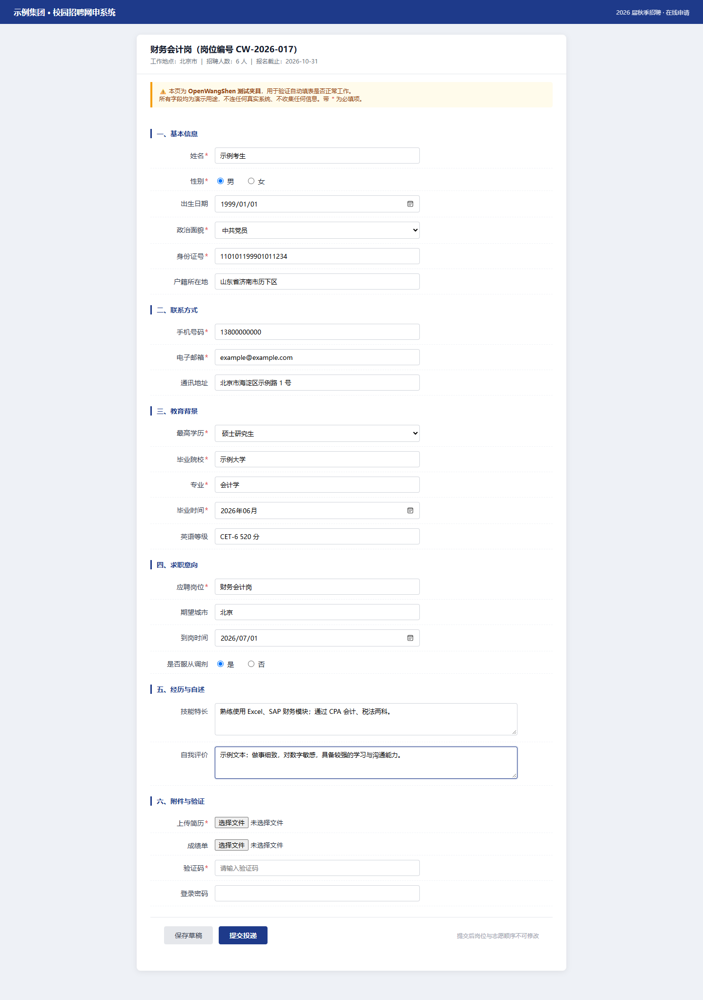

# OpenWangShen · 网申自动填写

> 把「对着空白网申表单逐框敲字」这件事，交给本机脚本。
> 你的身份信息**不出本机**，程序**不替你点提交**。

[English](README.en.md) | 简体中文

---

**先看效果** → [在线演示](https://liyang7078.github.io/OpenWangShen/demo/)：点一下就填完，全程零网络请求，你可以按 F12 自己验证。
（在线版打不开的话：直接双击仓库里的 `docs/demo/index.html`，效果完全一样。）
**直接使用** → 直接 clone 本仓库即可（体检 / 清单 / 脱敏三个功能**只用 Python 标准库**，零依赖）。

---

## 这是什么

一个**跑在你自己电脑上**的网申表单填写工具。它做四件事：

1. **体检** —— 检查你的个人档案有没有写全
2. **开填** —— 打开岗位页，自动识别表单字段，把信息填进去（**不提交**）
3. **清单** —— 打不开页面时，生成一份填写清单，你照着粘
4. **脱敏** —— 需要 AI 帮忙写开放题时，先把身份信息替换掉

**它是什么、不是什么：**

- ✅ **独立功能**。它不代你注册、不代你登录，也不要你的账号
- ✅ **只填**。它在你**已经打开的那个表单页**上工作，不管别的
- ❌ 不是海投机器。它不替你选岗、不替你投递、不替你提交
- ❌ 不绕过登录、不索取账号密码、不代过人机验证
- ❌ 不联网上传你的任何信息

> ⚠️ **用之前请先完成注册和登录，进到「填写简历信息」那个页面再运行。**
> 停在登录页、首页、岗位列表页上用，它只会告诉你「发现 0 个输入控件」——
> 因为那时候**页面上确实还没有表单**。

---

## 效果

下面是用仓库内 `fixtures/模拟网申页.html` 实拍的填写结果：
**22 个字段自动填入，附件 / 验证码 / 密码保持空白**（人工门，程序不碰）。



---

## 解决什么问题

央国企/大厂网申表单通常有 20–40 个字段，其中大量是**重复信息**：
姓名、身份证号、手机号、学校、专业、毕业时间、英语等级……

每投一家就要重敲一遍，敲错一位就可能影响资格。这个工具把这件事变成：

```
填一次档案  →  之后每家只需一条命令
```

---

## 三条红线（设计上不让步）

| # | 红线 | 为什么 |
|---|---|---|
| 1 | **绝不点提交** | 提交不可撤销、占用投递名额。程序填完就停，最后一步永远是你 |
| 2 | **绝不填密码、不碰验证码** | 识别到即标记为「人工门」，程序不触碰 |
| 3 | **身份信息不出本机** | 真值从档案直接写进浏览器或本地文件，**不经过任何网络、不进 AI 上下文** |

---

## 快速开始

> ⚠️ **本工具是独立功能，用之前有三件事必须先做：**
>
> 1. **自己完成注册** —— 它不代你注册，也不需要你的账号
> 2. **自己完成登录** —— 它不绕登录，也不帮你过人机验证
> 3. **进到「填写简历信息」那个页面之后再运行** —— 它扫描的是**当前打开页面**上的表单
>
> 停在登录页 / 首页 / 岗位列表页上跑，它只会打印「发现 0 个输入控件」。
> 那不是坏了，是那个页面上还没有表。

### 环境要求

- **Python 3.8+**（体检 / 清单 / 脱敏三个功能**只用标准库**）
- 自动填表另需 `playwright`（可选，缺了会自动降级到清单模式）

```bash
# 自动填表（可选）
pip install playwright
playwright install chromium
```

### 五步走

```bash
# 0. 【第一步，别跳过】先出空白问卷 —— 它列出网申会问的全部字段
python scripts/wangshen.py checklist --out 网申信息清单.md
#    ⚠️ 清单没填 → 就没有档案 → 后面每一步都无从谈起

# 1. 手上有简历？让它先替你抽一遍（省大半力气；本机抽取，不联网）
python scripts/wangshen.py resume --in 我的简历.docx
#    抽到的已填好，抽不到的留着待补。再照问卷把剩下的补进 profile.json
#    （.docx/.pdf 需要额外的库；缺了它会告诉你装哪个，也可以先另存为 .txt）

# 2. 体检
python scripts/wangshen.py check --profile profile.json

# 3. 填表（建议先 --dry-run 看能不能识别字段）
python scripts/wangshen.py fill --profile profile.json \
    --url "https://某公司招聘页" --dry-run
python scripts/wangshen.py fill --profile profile.json \
    --url "https://某公司招聘页" --screenshot filled.png
#    每站默认 300 秒预算：到点、或识别率过低，它自己停手，转第 4 步

# 4. 保底路径：填不动就生成「可复制清单页」，点一下就复制
python scripts/wangshen.py sheet --profile profile.json \
    --labels-file 页面字段.txt --out 填写清单.md
python scripts/wangshen.py sheethtml --in 填写清单.md
#    → 得到一个本机 HTML，浏览器打开，点「复制」再粘到网页对应框里

# 5. 遇到填不上的框？顺手记一条，下一个人就不必再踩
python scripts/wangshen.py report
#    答几个问题就行，格式不用你想。没有 GitHub 账号也没关系 ——
#    它默认就带一条「一键邮件」的通道。
```

不确定怎么走？打印使用路径：

```bash
python scripts/wangshen.py guide
```

---

## 术语对照

这个 README 里几个词，在这里一次说清：

| 词 | 指什么 |
|---|---|
| **档案** | 你自己的那份 `profile.json`，存着姓名/手机号/学历这些真实信息。**只在你本机** |
| **字段标签** | 网页上输入框旁边写的字，比如「联系人手机\*」。程序靠它判断「这是哪一项」。带 `*` 表示必填 |
| **指纹** | 一类**页面特征**的代号，比如「上传框被隐藏了」「下拉是自绘的」。它**不认站点**：形态一样就复用同一条经验 |
| **试用 / 固化** | 同一个坑想出几种修法，逐个真跑一遍比成绩，赢的那条才写进策略库长期生效。**没试赢过的不许固化** |
| **零真值 / 反证** | 程序对"即将写出去的内容"再扫一遍，确认没有任何能定位到真人的信息。命中即**中止** |
| **停手** | 到预算、识别率过低、扫不到字段时主动放弃并说明原因，**绝不假装成功**（退出码 5） |
| **三条线** | ① 绝不代替你点提交 ② 绝不填密码、绝不碰验证码 ③ 你的身份信息不出本机 |

---

## 工作原理

```
（还没有档案？）→ 生成《网申信息清单》空白问卷 → 逐项填 ──┐
                                                        ├→ profile.json（你的档案，只在本机）
（手上有简历？）→ 简历导入：本机正则抽取 → 预填 ─────────┘   （抽不到的不猜，留着待补）
        │
        ├─→ 体检 ──────────→ 缺什么字段
        │
        ├─→ 字段映射 ──────→ 页面标签 → 档案键（本地规则库，187 字段 / 731 标签）
        │                       │
        ├─→ 自动填表 ←─────────┘  真值直接写进浏览器（单站 300 秒预算）
        │      ├─ 打不开？→ 生成《填写清单》
        │      └─ 到点 / 识别率过低？→ 停手
        │                              └─→ 可复制清单页（点一下就复制）
        │
        ├─→ 脱敏通道 ──────→ 需要 AI 帮忙时，PII 先换成占位符
        │
        ├─→ 反馈包（考生侧）→ 填不上的框 → 一段可直接贴成 Issue 的文本（零真值）
        │
        └─→ 问题库 / 策略库 ─→ 遇到新坑就登记，试赢了解法就固化（见「它会自己变聪明」）
                 ▲
                 └── 回流收件台（作者侧）← GitHub Issue（inbox 一条命令收进来）
```

**关键设计**：填表是机械动作，不需要"思考"。所以真值可以不过 AI；
而需要"思考"的任务（写开放题、优化描述）反而不需要真值。
**这两件事天然可以分开** —— 这就是本工具隐私设计的地基。

---

## 目录结构

```
OpenWangShen/
├── scripts/
│   ├── core.py             核心库：规则加载 / 标签索引 / 字段映射
│   ├── check_profile.py    档案体检
│   ├── make_checklist.py   网申信息清单生成（投递前的空白问卷）
│   ├── import_resume.py    简历导入：本机抽取 → 预填档案（不联网）
│   ├── fill_form.py        自动填表（playwright，单站 300 秒预算 + 回读核对）
│   ├── start_browser.py    开一个可被接管的浏览器（复用登录态）
│   ├── make_sheet.py       填写清单生成（保底模式）
│   ├── sheet_html.py       可复制清单页（点一下就复制的本机网页）
│   ├── mask_pii.py         PII 脱敏通道
│   ├── report_feedback.py  反馈包（考生侧）：填不上的框 → 可提交的 Issue
│   ├── inbox.py            回流收件台（作者侧）：汇总反馈 → 逐条决定收不收
│   ├── gen_issue_template.py  Issue 模板生成器（选项集单一来源，--check 防漂移）
│   ├── dist_check.py       分发前真实值扫描（发布自检，五条判据）
│   ├── doc_check.py        文档数字一致性门：文档里的数字 vs 资产现算值（--fix 可改写）
│   ├── issue_registry.py   问题库：登记 / 状态机 / 按指纹匹配策略
│   ├── issue_trial.py      问题试验：多路径试跑 → 断言择优 → 固化
│   ├── htmlprobe.py        迷你 HTML 探针（自测与单测共用，断言结构而非文案）
│   └── wangshen.py         统一入口
├── assets/
│   ├── 字段规则_通用.json   字段知识库（187 字段 / 731 标签 / 15 组值域别名）
│   ├── 记录组_通用.json     记录组口径（11 组 / 65 项，可多条的表格结构）
│   ├── 问题库.jsonl        踩过的坑（公开子集：16 条，含失败的尝试）
│   ├── 站点策略.json        指纹 → 胜出解法（8 条策略 / 9 个控件指纹）
│   └── 反馈渠道.json        反馈回传配置（填了反馈邮箱就多一条零账号通道）
├── sites/                 站点适配库（按站点：字段选择器 + 选项映射）
├── fixtures/              测试夹具（示例档案 / 模拟网申页）
├── examples/              示例产物
├── tests/                 单元测试（151 项，纯标准库，无第三方测试框架）
├── .github/
│   ├── workflows/ci.yml   持续集成：Linux 四档 Python（含 3.8 下限）+ Windows 各跑一遍自测 / 单测 / 分发扫描
│   ├── ISSUE_TEMPLATE/    字段识别失败模板（由脚本生成，勿手改）
│   └── PULL_REQUEST_TEMPLATE.md
├── requirements.txt       依赖清单：核心零依赖，可选增强逐条说明缺了会怎样
├── SECURITY.md            安全与隐私政策（含**私密**报告漏洞的通道）
└── docs/                  详细文档（demo/ 为在线演示）
```

---

## 命令参考

| 命令 | 作用 |
|---|---|
| `wangshen.py checklist --out 网申信息清单.md` | **第一步**：生成空白问卷 |
| `wangshen.py resume --in 我的简历.docx` | 简历导入：本机抽成预填档案（不联网） |
| `wangshen.py check --profile p.json` | 档案体检（必填项缺失会提示） |
| `wangshen.py fill --profile p.json --url U [--dry-run]` | 自动填表，`--dry-run` 只映射不写入 |
| `wangshen.py browser` | 开一个可被接管的浏览器（真实网申站要登录，先跑这条） |
| `wangshen.py fill ... --connect 9222` | 接管那个浏览器，复用你的登录态 |
| `wangshen.py sheet --profile p.json --labels-file L.txt` | 生成填写清单 |
| `wangshen.py sheethtml --in 填写清单.md` | 可复制清单页（点一下就复制） |
| `wangshen.py report` | 反馈包：把填不上的框整理成可提交的 Issue |
| `wangshen.py report --mailto` | 同上，再加一条「一键邮件」（这条通道**默认就带**，零 GitHub 账号） |
| `wangshen.py inbox` | 回流收件台（维护者用）：汇总反馈，按优先级排序，逐条决定收不收 |
| `wangshen.py inbox --accept-all` | 里面所有没重复的一次性收进问题库 |
| `wangshen.py mask --profile p.json --in a.txt --out b.txt` | PII 脱敏 |
| `wangshen.py mask --profile p.json --in b.txt --out c.txt --restore` | 还原 |
| `wangshen.py issue --list` | 看问题库（踩过的坑） |
| `wangshen.py issue --match 北森:label-missing,portal-to-body` | 按站点 + 控件指纹查解法 |
| `wangshen.py issue --report --out 问题库报告.md` | 生成问题库报告 |
| `wangshen.py trial --issue Q-... --path "名=命令" --assert "指标 > 0"` | 多路径试跑择优 |
| `wangshen.py trial ... --promote --动作 "..." --指纹 x` | 把胜出解法固化进策略库 |
| `wangshen.py template --check` | 校验 Issue 模板与脚本选项集**没漂移**（CI 也跑这条） |
| `wangshen.py docs` | 校验文档里的数字 == 资产现算值、示例产物 == 生成器输出（CI 也跑这条） |
| `wangshen.py docs --fix` | 同上，但直接把不一致的数字改写掉（改前自动留 `.bak`） |
| `wangshen.py selftest` | 全部自测 |
| `wangshen.py guide` | 打印使用路径 + **术语对照** |

**常用选项**

| 选项 | 说明 |
|---|---|
| `--channel msedge\|chrome` | 用哪个浏览器内核（默认 msedge） |
| `--proxy http://127.0.0.1:端口` | 浏览器代理。**Chromium 不读环境变量，必须显式传** |
| `--headed` | 显示浏览器窗口（默认无头） |
| `--wait 毫秒` | 打开页面后，等「真的出现输入控件」的最长时间（默认 8000）。等不到不算错，会由停手逻辑说明原因 |
| `--screenshot 路径` | 截图留存 |
| `--budget 秒` | 单站硬预算（默认 300，0 = 不限）。到点自动停手，转可复制清单页 |
| `--html 路径` | 提前停手时，直接生成可复制清单页到该路径 |
| `--connect 9222` | 接管已登录的浏览器（先跑 `wangshen.py browser`）。**只接管页面，不碰账号密码** |
| `--allow-local` | 放行本机/内网地址（默认拒绝 `file://`、内网 IP，仅自测时需要） |
| `--overwrite` | 允许覆盖同名产物。**默认不覆盖**：同名就改存带时间戳的新名，旧文件一个字节都不动 |

---

## 它会自己变聪明

站点成百上千，一个个写适配写不完。但踩到最后会发现：**大多数坑根本不认站点。**

「组件库把控件 portal 到 body」「上传 input 被隐藏」「下拉是虚拟列表」——
这些在北森、Moka、用友、自建站上一模一样地再现。**按站点记，等于同一件事记 N 遍。**

所以经验按**控件指纹**（不是按站点）组织：

| 文件 | 是什么 | 什么时候写 |
|---|---|---|
| `assets/问题库.jsonl` | 踩过的坑 + 试过的路径（**失败的也留**） | 遇到就登记 |
| `assets/站点策略.json` | 只有**试赢过**的解法才进来，引擎运行时按指纹查 | 试赢才固化 |
| `sites/*.json` | 这个控件在这个站点的选择器 | 按站点贡献 |

**「赢」不能靠嘴说，得靠断言**：`issue_trial.py` 给同一问题登记 N 条候选路径，
每条拿指标筛（**指标缺失一律算不过**），固化前跑全量回归，**回归失败一个字节都不落盘**。
规矩是写死的：待试验 → 试验中 → 已胜出 → 已固化，**没试赢过的不许进策略库**。

**为什么值得这么做**：一次登记，换个站点遇到同类控件直接命中，
不必再从头摸一遍 —— 这是本工具**越用越快**的那部分。

### 关于这份库

- `assets/问题库.jsonl` 是**公开子集**（16 条）：只收录通用控件问题，与具体岗位、
  投递策略相关的条目不在本仓库范围。因此 **ID 不连续是正常的**。
- 两份库都是**问题级产物**：只含站点、控件指纹、现象与解法，**不含任何真实个人值**。
  `dist_check.py` 与库自身的 `pii_scan` 双重把关，掺真值即**中止、不写盘**。

### 想贡献一条？

最省事的入口是这条命令 —— 不用会写 JSON，也不用懂「指纹」这些词：

```bash
python scripts/wangshen.py report
```

它把你遇到的问题整理成一段可直接提交的 Issue 文本。想深入改规则库，
见 [CONTRIBUTING.md](CONTRIBUTING.md) 的「四、补控件指纹与策略」。

> 维护者侧：`python scripts/wangshen.py inbox` 会把 GitHub 上的反馈汇总成一屏，
> 每条给出「值得收 / 已有解 / 同字段」的建议，再按编号收或丢。

---

## 常见问题

**Q：真值真的不进 AI 上下文吗？**
是。填表脚本从档案取值后直接写进浏览器，终端只打印「字段名 + 就绪/缺项」，
**不打印任何值**。清单模式同理，值只写进本地文件。

**Q：为什么 `--dry-run` 很有用？**
它只做映射不写入，能提前看出「这个页面哪些字段识别不了」。
识别不了的字段不会被瞎猜，会如实列出来。

**Q：浏览器打不开页面怎么办？**
最常见的原因是代理。Chromium 系浏览器**不读 `HTTP_PROXY` 环境变量**，
需要显式传 `--proxy`。另外，打不开不是死路 —— 用 `sheet` 子命令生成清单即可。

**Q：填错了怎么办？**
`--dry-run` 先跑一遍。另外程序**永远不提交**，你有充分时间核对。

**Q：支持哪些招聘系统？**
任何标准 HTML 表单都可以尝试。字段识别靠 `assets/字段规则_通用.json`
的标签匹配，**未命中的字段会交给你手填，不会瞎猜**。
遇到识别不了的字段，欢迎提 Issue 或直接补规则库（见 CONTRIBUTING）。

**Q：某个框就是填不上，怎么办？**
三条路，从稳到快：

1. `wangshen.py sheet` + `sheethtml` 生成**可复制清单页**，点一下就粘过去（最稳）
2. `wangshen.py fill` 会自己停手 —— 单站跑满 300 秒、或识别率低于 20% 就停，不白耗
3. 跑 `wangshen.py report` 记一条反馈：哪个框、哪个系统、什么结果。
   你提一次，**下一个遇到同一控件的人就不用再摸一遍**

**Q：跑起来说「发现 0 个输入控件」？**
多半是**页面还没走到表单**。先注册 / 登录，进到「填写简历信息」那一页再运行 ——
本工具只看**当前页面**上的表单，不会替你点按钮往下走。这是设计如此，不是缺陷。

---

## 隐私说明

- `profile.json` 只存放于本机。`.gitignore` 已屏蔽相关文件名，**请勿提交**
- 脱敏采用**白名单**策略：只替换「能唯一定位到某个人」的字段
  （姓名/手机号/身份证/邮箱/地址…）。
  「性别=男」「政治面貌=党员」**不替换** —— 它们定位不到人，脱了反而让文本没法用
- 脱敏后会自动做**二验**：再扫一遍确认无残留，未通过则拒绝输出
- 映射表只在内存里存活一次，**不落盘、不写日志**
- **产物默认不覆盖**：同名就改存带时间戳的新名（要覆盖请显式加 `--overwrite`）。
  写入走原子替换，写一半崩掉不会留下半个文件
- **写盘前有零真值反证**：反馈包/问题库掺进手机号、身份证、本机路径等，
  一律**中止不写盘**（不是警告、不是脱敏后放行）

详见 [docs/隐私设计.md](docs/隐私设计.md) 与 [SECURITY.md](SECURITY.md)
（后者含**私密**报告安全缺陷的通道 —— 这类问题请不要开公开 Issue）。

---

## 免责声明

- 本工具只做**表单填写**，不保证任何投递结果
- 请遵守目标网站的服务条款。使用本工具产生的后果由使用者自行承担
- **投递前请务必核对**填写内容，尤其是身份证号、手机号等关键字段

---

## 许可

[MIT](LICENSE)

---

## 作者

**作者：liyang7078**

遇到字段识别失败、或者想补充规则，欢迎直接提
[Issue](../../issues) 或 [Pull Request](../../pulls)。

**不知道怎么描述？** 跑一条命令就行 —— 它会问几个问题，然后给你一段
**可以直接粘贴成 Issue** 的文字，格式不用你自己想：

```bash
python scripts/wangshen.py report
```
